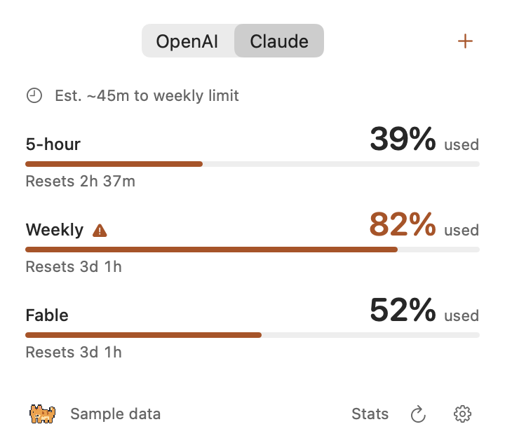

# Relay Cat

[](https://github.com/Relay-harness/relay-cat/actions/workflows/ci.yml)
[](LICENSE)

Miso is a small macOS cat that sits on your menu bar to tell you how much of your **subscription quota is used**, **reset times**, and a cautious estimate of **time to the next limit**.

Miso is made to be quiet and respectful. No analytics, keyboard recording, feeding mechanics, or achievements. Community quota sharing is separately opt-in in new source builds.

<picture>
  <source media="(prefers-color-scheme: dark)" srcset="docs/assets/usage-dark.png">
  
</picture>

**Public preview · Apple Silicon · macOS 14+**. The screenshot is synthetic. Provider support does not guarantee that every account exposes a compatible quota endpoint.

## What it does

- OpenAI **Codex** and Claude by default; add Gemini or Grok with **+**.
- Full-width vertical bars show **percentage used**. At 82% used the bar is 82% full.
- Shows the earliest calibrated pre-reset exhaustion estimate. It needs matching account/window/reset identity and at least three fresh measurements, normally about ten minutes. Missing data is never invented.
- Click the cat to wake it and open usage. Close the popover and it naps after about two seconds. Manual wake/nap remains an override. Native light/dark mode and Reduce Motion are respected.
- Optional local input/output token statistics live on a separate Stats view. These are not subscription messages or allowance denominators.

## Opt-in community quota dashboard (source-build feature)

The `dashboard/` web app now targets experimental five-hour and weekly effective-allowance changes, rather than treating quota used as a limit cut. Its signed estimator and optional native Claude Sonnet 4.5 calibration adapter are implemented. Calibration is user-started, runs a bounded public workload that consumes quota, and requires separate consent plus coverage confirmation before upload. Ordinary quota reports cannot populate allowance-change results; native Codex calibration and real-provider validation remain unfinished. See [measurement method, calibration controls and limitations](docs/ALLOWANCE_CHANGES.md). Legacy signed usage cohorts from consenting Relay Cat installations remain available separately. Sharing is off by default and separate from local quota access. Provider credentials stay on the Mac. Small cohorts remain hidden; no demo participants are seeded. Internet discussions are secondary.

This is pseudonymous, client-reported measurement, not provider attestation or a verified count of people. The collector and updated app must be built/configured; no public deployment or retroactive opt-in of existing downloads is included. See [setup, algorithm and privacy](docs/COMMUNITY_SIGNALS.md).

**Message counts:** the current quota feed does not expose exact human messages used or a fixed messages-left allowance. Stats says **Not reported**. Tokens and tool/API requests are not converted into guessed message counts.

**Not included:** verified terminal-task 429 detection, workspace packaging/upload, or an E2B/Relay runner connector. A failed quota poll is not proof that a task is locked out.

## Install with Homebrew


Requires Apple Silicon, macOS 14+ and [Homebrew](https://brew.sh/):

```sh
brew install --cask relay-harness/tap/relay-cat
```

Quit any older Relay Cat copy, then open **Relay Cat** from Applications. The official [tap](https://github.com/Relay-harness/homebrew-tap) verifies the release ZIP against a pinned SHA-256. To update, quit Relay Cat, run `brew update`, then `brew upgrade --cask relay-harness/tap/relay-cat`.

**Homebrew makes installation easier, not Apple-verified. This preview is ad-hoc signed and not notarized.** If macOS blocks the first launch with an unverified-developer warning, review the source/release first. Only if you trust it: try opening the app once, then choose **System Settings → Privacy & Security → Open Anyway**, authenticate if asked, and confirm **Open**. Control-click → Open alone may not work on current macOS. Do not override a malware/“will damage your computer” alert. Never disable Gatekeeper system-wide. The cask does not remove quarantine.

See [Homebrew installation, updates and troubleshooting](docs/HOMEBREW.md), or [download the preview ZIP and checksum](https://github.com/Relay-harness/relay-cat/releases/tag/v1.8.1).

## Build from a clean checkout

Requires an Apple Silicon Mac to run the app, Apple Command Line Tools (`xcode-select --install`), and Python 3.9+ (`python3`). No Python packages or package-manager install is needed.

```sh
git clone https://github.com/Relay-harness/relay-cat.git
cd relay-cat
python3 Scripts/test.py
python3 Scripts/build.py
open "build/Relay Cat.app"
```

The build generates the original icon, creates Info.plist/resources, downloads the pinned CodexBar CLI release, verifies its SHA-256, compiles the app, and ad-hoc signs it. The helper is **not** committed as a binary. The first build needs internet access; subsequent builds can use `python3 Scripts/build.py --offline` with a verified cached archive.

Build scripts can cross-compile the arm64 app on an Intel macOS build host; the resulting app is **not an Intel app**. Core/reader tests run for the build host. Interactive UI tests require Apple Silicon.

To install, quit any older Relay Cat instance and copy `build/Relay Cat.app` to your Applications folder. Downloadable preview binaries, when provided, are **ad-hoc signed and not notarized**. Review the source/checksum and follow macOS's explicit Privacy & Security approval flow only if you trust the build. Do not disable Gatekeeper system-wide.

## Connect

The cat and timer work offline. Quota access starts **off**. Click **Connect** and review the consent dialog.

- **Claude:** install Claude Code and authenticate its default profile with `claude auth login`.
- **OpenAI:** install Codex and authenticate with `codex login`. This is Codex quota, not a universal ChatGPT model/message counter or API balance.
- **Gemini:** add the tab, sign in to the Gemini app in a supported browser, then separately approve browser access. Gemini CLI/API quota is not substituted.
- **Grok:** add the tab and use the supported Grok CLI's subscription OAuth sign-in. API wallet credit is not substituted.

The footer refresh button also supports **Cmd-R**. Settings → **Data permissions…** lets you revoke live quota, local-stat, and separately approved Gemini access. No login or API key is shipped with Relay Cat. See [authentication and provider limits](docs/PROVIDERS.md).

## Tests and packaging

```sh
python3 Scripts/check_source.py
python3 Scripts/test.py
python3 Scripts/test.py --native-ui
python3 Scripts/package.py
```

The native command builds the app and opens an owned test popover on an interactive Apple Silicon desktop. Tests use fixture data and isolated preferences; they do not authenticate accounts or scan private conversation logs. CI runs publication checks, core/reader tests, a clean app build, and packaging; it does not claim hosted-runner GUI or live-account coverage.

## Privacy and persistence

Relay Cat itself has no analytics or keystroke recorder. The helper can use existing provider logins/owner CLIs after consent; Gemini browser access and local token scans have separate approvals. Third-party owner CLIs may have their own settings/telemetry. Relay Cat does not persist raw quota responses, account emails, prompts, or transcript text. Forecast history and timers are in memory. See [PRIVACY.md](PRIVACY.md).

Relay Cat uses preference domain `org.relayharness.relay-cat`. When moving from Miso Track, quit the old app and approve data permissions again; shared provider CLI sign-ins are unchanged. An earlier private/local Relay Cat build may use another domain; public builds require their own consent. Removing Relay Cat does not log you out of provider CLIs.

## Project

- [Contributing](CONTRIBUTING.md) · [Support](SUPPORT.md) · [Security](SECURITY.md)
- [Code of conduct](CODE_OF_CONDUCT.md) · [Maintainers](MAINTAINERS.md) · [Changelog](CHANGELOG.md)
- [MIT license](LICENSE) · [Third-party notices](THIRD_PARTY_NOTICES.md)

Independent community software, not affiliated with Anthropic, OpenAI, Google, xAI, or the authors of upstream provider CLIs. Private endpoints and CLI output formats can change. Forecasts are estimates, not guarantees of available service.
